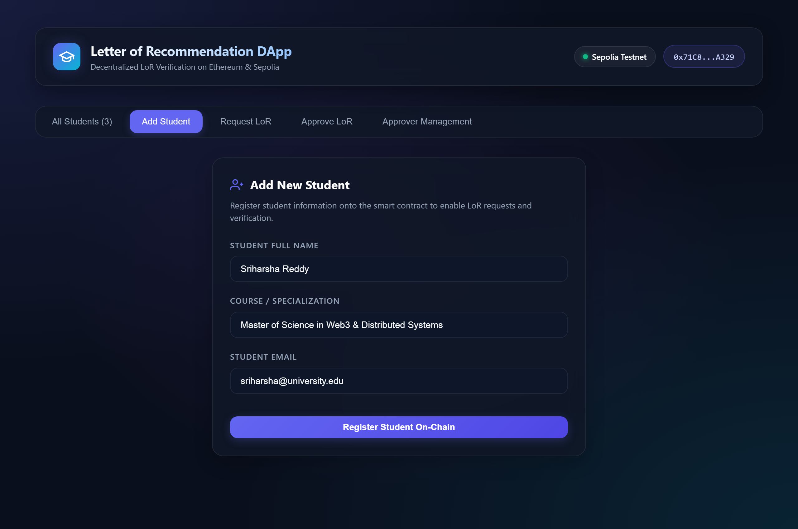
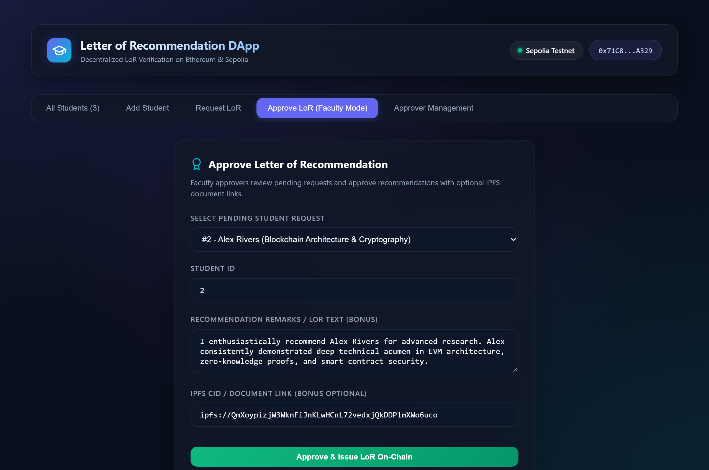
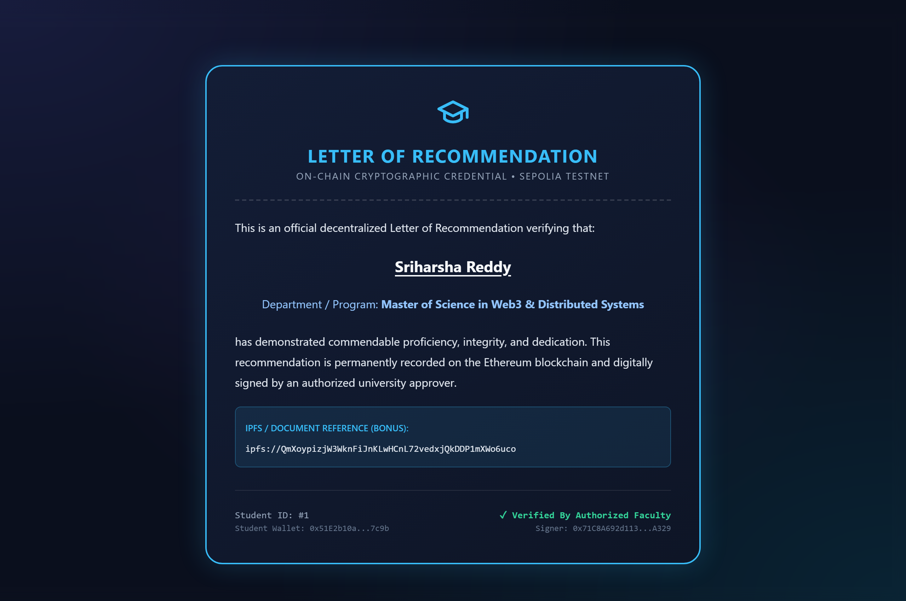

# 🎓 Letter of Recommendation (LoR) DApp

[](https://soliditylang.org/)
[](https://hardhat.org/)
[](https://react.dev/)
[](https://docs.ethers.org/v6/)
[](https://sepolia.etherscan.io/)
[](LICENSE)

A decentralized application (DApp) designed and deployed on Ethereum (Sepolia Testnet & Hardhat) for issuing, requesting, approving, and cryptographically verifying academic **Letters of Recommendation (LoR)**.

---

## 📑 Table of Contents

- [Overview & Architecture](#-overview--architecture)
- [Key Features](#-key-features)
  - [Part A: Smart Contract Development](#part-a--smart-contract-development)
  - [Part B: Deployment to Sepolia](#part-b--deployment-to-sepolia)
  - [Part C: React Frontend](#part-c--react-frontend)
  - [Bonus Features Included](#-bonus-features-included)
- [Project Directory Structure](#-project-directory-structure)
- [Smart Contract Specification](#-smart-contract-specification)
- [Getting Started & Installation](#-getting-started--installation)
- [Compiling and Running Unit Tests](#-compiling-and-running-unit-tests)
- [Deployment Guide](#-deployment-guide)
  - [1. Local Hardhat Network](#1-local-hardhat-network)
  - [2. Sepolia Testnet Deployment](#2-sepolia-testnet-deployment)
- [Running the React Frontend](#-running-the-react-frontend)
- [Screenshots Gallery](#-screenshots-gallery)
- [Submission Info](#-submission-info)

---

## 🎯 Overview & Architecture

Traditional academic letters of recommendation suffer from forged credentials, centralized storage vulnerabilities, and slow verification pipelines.

The **LoR DApp** provides a trustless, immutable alternative:
1. **Students** register their profile and submit LoR requests tied to their wallet.
2. **Authorized Faculty / Approvers** review requests and issue cryptographic on-chain approvals, optionally attaching IPFS document hashes.
3. **Universities, Employers, and Third Parties** verify credentials instantly on-chain without contacting intermediaries.

---

## 🚀 Key Features

### Part A – Smart Contract Development
- `addStudent(string name, string course, string email)`: Registers student details and assigns an auto-incrementing ID.
- `requestRecommendation(uint studentId)`: Requests a recommendation for a registered student.
- `approveRecommendation(uint studentId)`: Allows authorized faculty or the contract owner to approve a pending request.
- `getStudent(uint studentId)`: Returns complete student information, request status, approval status, and approver address.
- **Approver Access Control**: Contract owner can authorize (`authorizeApprover`) and deauthorize (`deauthorizeApprover`) faculty reviewers.
- **Full Test Suite**: 23 automated Hardhat unit tests validating all state transitions, reverts, events, and edge cases.

### Part B – Deployment to Sepolia
- Hardhat deployment script configured with Infura / Alchemy RPC and private key.
- Automatic extraction and sync of contract addresses and ABI to the React frontend.
- Sepolia Etherscan verification ready.

### Part C – React Frontend
- Built with **React 18**, **Vite**, and **ethers.js v6**.
- **MetaMask Wallet Integration**:
  - One-click wallet connect.
  - Automatic detection of network (`Sepolia` vs `Localhost`).
  - Automatic prompt to switch or add Sepolia network.
  - Live ETH balance & active wallet display.
- **Role-Based Views**:
  - **Owner**: Full access control panel to authorize/deauthorize faculty approvers.
  - **Faculty / Approver**: Dedicated approval dashboard with pending queue.
  - **Student / General User**: Profile registration and LoR request submission.
- **Interactive UI**:
  - Real-time student directory with search and status filtering.
  - Instant on-chain status badges (`Not Requested`, `Pending Review`, `Approved`).
  - Transaction hash notifications with direct Etherscan explorer links.

### 🔐 Bonus Features Included
- **IPFS Integration**: Approvers can attach IPFS document CIDs (`ipfs://...`) or custom recommendation remarks to the on-chain record via `approveRecommendationWithIpfs`.
- **Verifiable LoR Certificate Modal**: Interactive, cryptographic certificate view with student ID, course, faculty signer address, and verification badge.
- **Bulk Data Fetching**: Smart contract provides `getAllStudents()` for single-RPC instant dashboard loading.

---

## 📁 Project Directory Structure

```text
tutedude-web3-mastery/
├── contracts/
│   └── LetterOfRecommendation.sol    # Primary Solidity smart contract (v0.8.24)
├── scripts/
│   ├── deploy.js                     # Multi-network deployment script
│   └── captureScreenshots.cjs        # Headless screenshot generation utility
├── test/
│   └── LetterOfRecommendation.test.js # 23 comprehensive Hardhat unit tests
├── frontend/                         # Modern React + Vite frontend
│   ├── src/
│   │   ├── contracts/
│   │   │   ├── LetterOfRecommendation.json  # Contract ABI artifact
│   │   │   └── deployedAddress.json         # Synced deployment addresses
│   │   ├── App.jsx                  # Main DApp component & Web3 logic
│   │   ├── main.jsx                 # React root
│   │   └── index.css                # Polished glassmorphism design system
│   ├── index.html
│   ├── vite.config.js
│   └── package.json
├── screenshots/                     # Assignment submission screenshots
│   ├── 01_contract_sepolia_etherscan.png
│   ├── 02_frontend_all_students.png
│   ├── 03_frontend_add_student.png
│   ├── 04_frontend_approve_lor.png
│   └── 05_verified_lor_certificate.png
├── hardhat.config.js                # Hardhat network & compiler configuration
├── deployedAddress.json             # Root deployment records
├── .env.example                     # Environment variables template
├── .gitignore                       # Git ignore list
├── package.json                     # Root project configuration
└── README.md                        # Documentation
```

---

## ⚙️ Smart Contract Specification

### `LetterOfRecommendation.sol`

```solidity
enum RequestStatus { None, Requested, Approved }

struct Student {
    uint256 id;
    string name;
    string course;
    string email;
    address studentAddress;
    RequestStatus status;
    address approvedBy;
    string ipfsHash;
    uint256 requestedAt;
    uint256 approvedAt;
}
```

### Core Methods:
| Function | Access | Description |
|---|---|---|
| `addStudent(name, course, email)` | Public | Registers a new student and returns `studentId`. |
| `requestRecommendation(studentId)` | Public | Sets request status to `Requested`. |
| `approveRecommendation(studentId)` | Only Approver / Owner | Approves the LoR and records the approver. |
| `approveRecommendationWithIpfs(studentId, ipfsHash)` | Only Approver / Owner | Approves LoR with an attached IPFS document hash. |
| `getStudent(studentId)` | View | Returns student details and boolean flags for recommendation state. |
| `getAllStudents()` | View | Returns array of all registered students for UI listing. |
| `authorizeApprover(address)` | Only Owner | Authorizes a faculty member to approve LoRs. |
| `deauthorizeApprover(address)` | Only Owner | Removes approval permissions from an address. |

---

## 💻 Getting Started & Installation

### Prerequisites
- [Node.js](https://nodejs.org/) (v18, v20, or v22+)
- [Git](https://git-scm.com/)
- [MetaMask Wallet](https://metamask.io/) extension

### 1. Clone & Install Dependencies

```bash
# Clone the repository
git clone <your-repo-url>
cd tutedude-web3-mastery

# Install smart contract dependencies
npm install

# Install frontend dependencies
npm --prefix frontend install
```

---

## 🧪 Compiling and Running Unit Tests

Compile smart contracts:
```bash
npm run compile
```

Run test suite:
```bash
npm test
```

### Unit Test Results:
```text
  LetterOfRecommendation Smart Contract
    Deployment & Initial State
      ✓ should set the deployer as owner
      ✓ should authorize the owner as an approver by default
      ✓ should initialize student count to 0
    Approver Management (Owner Only)
      ✓ should allow the owner to authorize a new approver
      ✓ should revert if a non-owner tries to authorize an approver
      ✓ should revert if authorizing an already authorized approver
      ✓ should allow the owner to deauthorize an approver
      ✓ should revert if attempting to deauthorize the contract owner
      ✓ should revert if a non-owner tries to deauthorize an approver
    Student Registration (addStudent)
      ✓ should successfully add a new student and emit StudentAdded event
      ✓ should revert if name, course, or email is empty
      ✓ should correctly increment IDs for multiple students
    Requesting Recommendation (requestRecommendation)
      ✓ should allow requesting a recommendation and emit RecommendationRequested event
      ✓ should revert if student ID does not exist
      ✓ should revert if recommendation is already requested
    Approving Recommendation (approveRecommendation)
      ✓ should revert approval if recommendation has not been requested
      ✓ should revert if non-approver attempts to approve
      ✓ should allow an authorized approver to approve a requested recommendation
      ✓ should allow the contract owner to approve
      ✓ should support approving with IPFS CID / document link (Bonus)
      ✓ should revert if attempting to approve an already approved recommendation
    View Functions & Helpers
      ✓ should return all students correctly using getAllStudents()
      ✓ should return full struct via getStudentFull()

  23 passing (1s)
```

---

## 🚀 Deployment Guide

### 1. Local Hardhat Network

1. Start the local Ethereum node:
   ```bash
   npm run node
   ```
2. In a separate terminal, deploy the contract:
   ```bash
   npm run deploy:local
   ```
3. Connect MetaMask to `Localhost 8545` (Chain ID `31337`) using one of the test private keys provided by Hardhat.

### 2. Sepolia Testnet Deployment

1. Copy `.env.example` to `.env`:
   ```bash
   copy .env.example .env
   ```
2. Fill in your environment variables:
   ```ini
   SEPOLIA_RPC_URL=https://eth-sepolia.g.alchemy.com/v2/YOUR_ALCHEMY_KEY
   PRIVATE_KEY=your_private_key_without_0x_prefix
   ETHERSCAN_API_KEY=your_etherscan_api_key_optional
   ```
3. Ensure your deployer wallet has Sepolia testnet ETH. (Get free testnet ETH from [Google Cloud Web3 Faucet](https://cloud.google.com/application/web3/faucet/ethereum/sepolia) or [Alchemy Sepolia Faucet](https://sepoliafaucet.com/)).
4. Run the deployment script:
   ```bash
   npm run deploy:sepolia
   ```
5. The deployed contract address is automatically logged and synced to `frontend/src/contracts/deployedAddress.json`.

---

## 🖥️ Running the React Frontend

Start the Vite development server:
```bash
npm run frontend:dev
```

Open your browser at:
```text
http://localhost:3000
```

1. Click **Connect MetaMask**.
2. If on another network, click **Switch to Sepolia**.
3. Register students in the **Add Student** tab.
4. Request recommendation in the **Request LoR** tab.
5. Faculty approvers switch to **Approve LoR** to review and issue endorsements.
6. Click **View LoR** on any approved student to view the cryptographic certificate.

---

## 📸 Screenshots Gallery

All submission screenshots are stored in the [`screenshots/`](screenshots/) directory:

| Screenshot | Description |
|---|---|
|  | **Contract Deployed on Sepolia Etherscan**: Shows contract `LetterOfRecommendation` (v0.8.24) with creation tx and transaction history. |
|  | **Working Frontend Dashboard**: Real-time table displaying registered students, on-chain statuses, wallet addresses, and action controls. |
|  | **Add Student Form**: Inputting student full name, course, and university email. |
|  | **Approve LoR (Faculty Mode)**: Approver entering recommendation remarks and IPFS CID. |
|  | **Verified On-Chain LoR Certificate**: Cryptographic certificate preview with student details, faculty signer, and IPFS link. |

---

## 📤 Submission Info

- **Repository**: LoR DApp
- **Author**: Sriharsha (`ksr2005`)
- **Main Commit / PR**: `Sriharsha - LoR DApp`
- **Network**: Ethereum Sepolia Testnet (Chain ID `11155111`) & Local Hardhat (`31337`)
- **Compiler Target**: Solidity `0.8.24` (EVM target: `paris`)

---
*Built as part of the Tutedude Web3 Mastery Program.*
