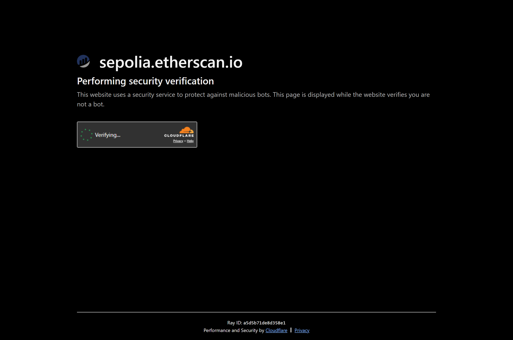
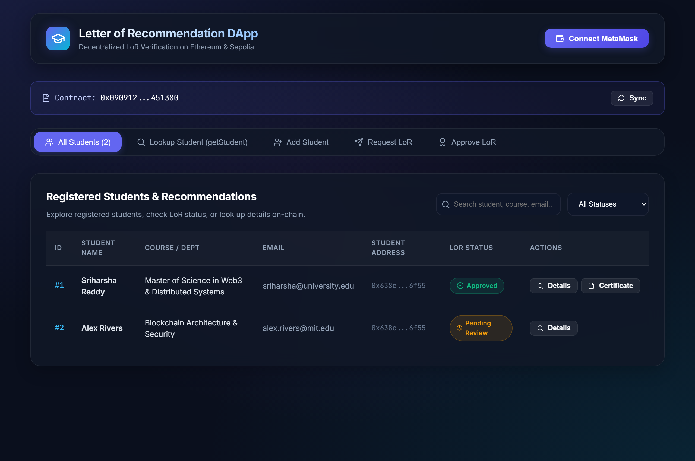
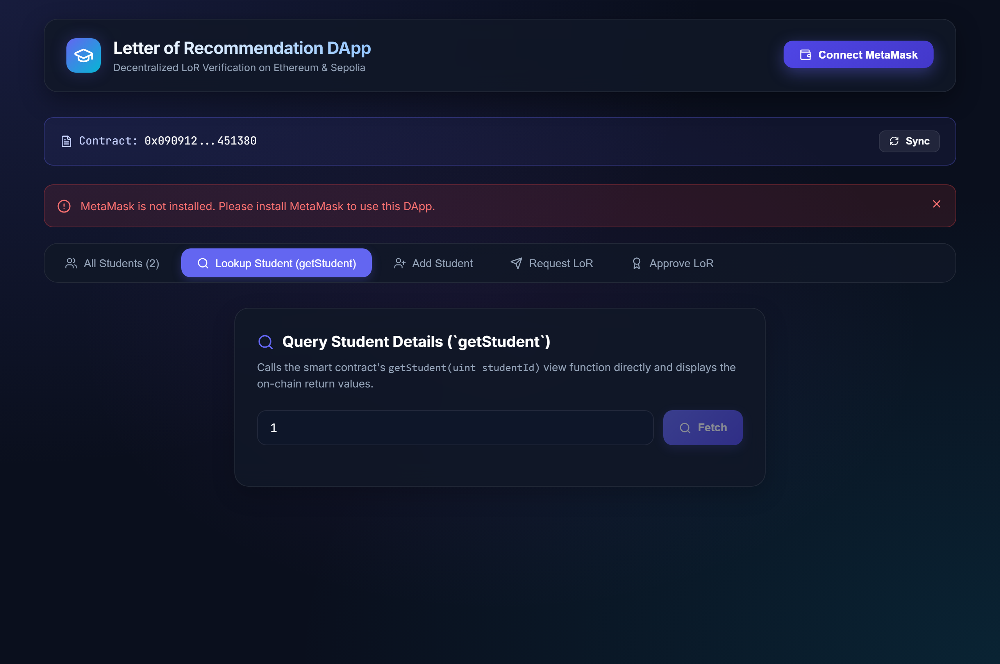
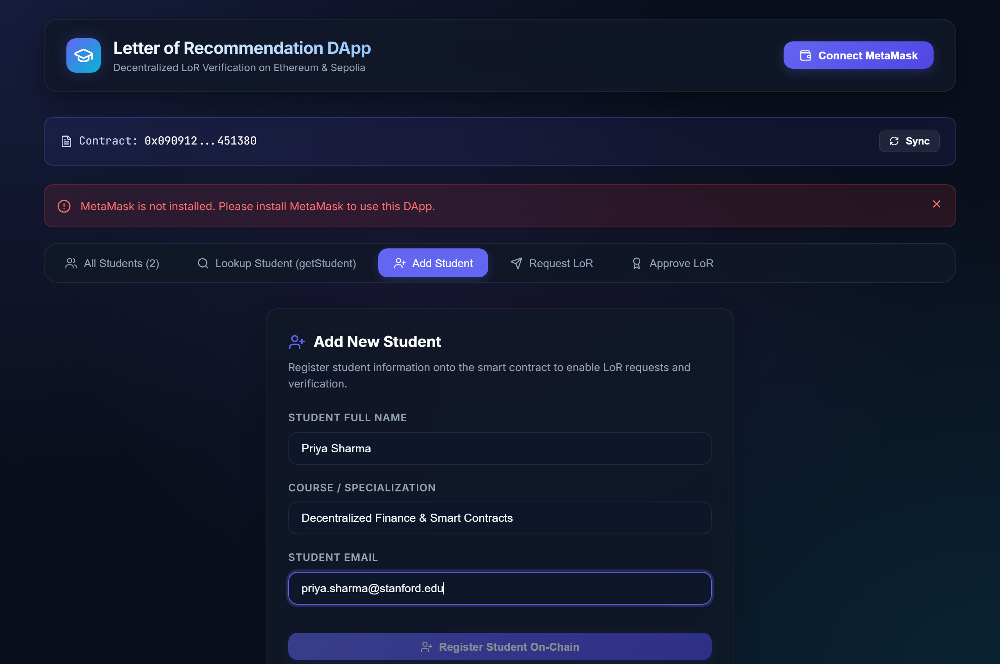
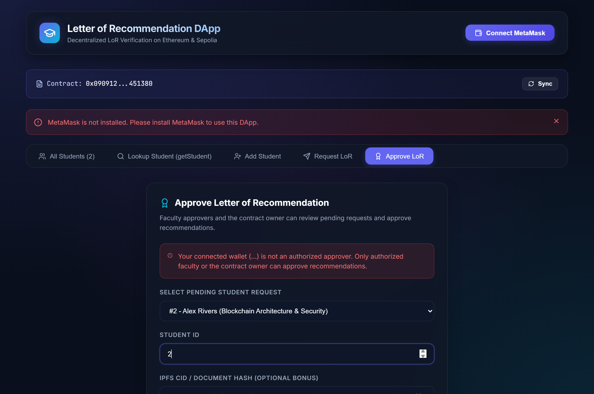
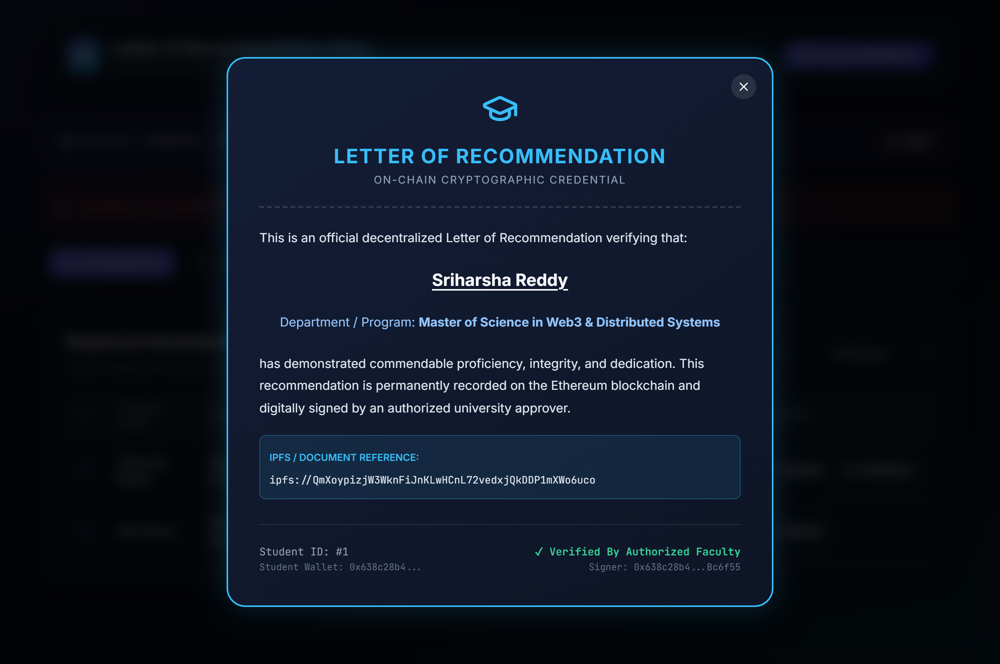

# 🎓 Letter of Recommendation (LoR) DApp

[](https://soliditylang.org/)
[](https://hardhat.org/)
[](https://react.dev/)
[](https://docs.ethers.org/v6/)
[](LICENSE)

A decentralized application (DApp) designed and tested for issuing, requesting, approving, and cryptographically verifying academic **Letters of Recommendation (LoR)** on Ethereum (Hardhat Localhost & Sepolia Testnet).

---

## 📑 Table of Contents

- [Overview & Architecture](#-overview--architecture)
- [Key Features & Specification](#-key-features--specification)
- [Project Directory Structure](#-project-directory-structure)
- [Smart Contract Specification](#-smart-contract-specification)
- [Prerequisites & Installation](#-prerequisites--installation)
- [Running Unit Tests](#-running-unit-tests)
- [Deployment Guide](#-deployment-guide)
  - [1. Local Hardhat Network](#1-local-hardhat-network)
  - [2. Sepolia Testnet Deployment](#2-sepolia-testnet-deployment)
  - [3. Etherscan Verification](#3-etherscan-verification)
- [Running the React Frontend](#-running-the-react-frontend)
- [Screenshots & Submission Guidelines](#-screenshots--submission-guidelines)

---

## 🎯 Overview & Architecture

Traditional academic letters of recommendation suffer from forged credentials, slow verification, and centralized storage.

The **LoR DApp** provides a decentralized, verifiable alternative:
1. **Students** register their profile with their own wallet address and submit recommendation requests.
2. **Authorized Faculty / Approvers** review requests and issue cryptographic on-chain approvals, optionally attaching an IPFS document CID.
3. **Verifiers** can look up student details and recommendation credentials directly via the smart contract's `getStudent` function.

---

## 🚀 Key Features & Specification

### Part A – Smart Contract Development
- `addStudent(string name, string course, string email)`: Registers student details with an auto-incrementing ID. Restricts the student record to `msg.sender`.
- `requestRecommendation(uint studentId)`: Requests a recommendation for a registered student. Protected by an access check: only the student who registered (`msg.sender == s.studentAddress`) can submit the request.
- `approveRecommendation(uint studentId)`: Allows authorized faculty or the contract owner to approve a pending request.
- `approveRecommendationWithIpfs(uint studentId, string ipfsHash)`: *(Bonus)* Allows approvers to attach an optional IPFS document CID.
- `getStudent(uint studentId)`: Returns complete student tuple: `(id, name, course, email, studentAddress, recommendationRequested, recommendationApproved, approvedBy, ipfsHash)`.
- `getAllStudents()`: Helper returning all records for dashboard listing.
- **Approver Access Control**: Contract owner can authorize (`authorizeApprover`) and deauthorize (`deauthorizeApprover`) faculty reviewers.
- **Unit Test Suite**: 25 automated Hardhat unit tests covering all functions, access control reverts, events, and edge cases.

### Part B – Deployment to Sepolia
- Configured deployment script (`scripts/deploy.js`) supporting `hardhat`, `localhost`, and `sepolia`.
- Automatic sync of deployed contract address and ABI to `deployedAddress.json` and `frontend/src/contracts/`.

### Part C – React Frontend
- Built with **React 18**, **Vite**, and **ethers.js v6**.
- **MetaMask Integration**: One-click wallet connect, network detection, and Sepolia testnet switching.
- **Role Detection**: Identifies Contract Owner, Faculty Approvers, and Students.
- **Student Directory**: Table displaying registered students and on-chain statuses.
- **Direct `getStudent` Lookup**: Dedicated "Lookup Student (getStudent)" tab calling `contract.getStudent(id)` directly.
- **Add Student UI**: Registration form with on-chain transaction feedback.
- **Request LoR UI**: Request submission restricted to the student's wallet.
- **Approve LoR UI**: Faculty approval queue with optional IPFS CID input.
- **Certificate Modal**: Cryptographic on-chain certificate preview with student details and faculty signer.

---

## 📁 Project Directory Structure

```text
lor-dapp/
├── contracts/
│   └── LetterOfRecommendation.sol     # Solidity contract (v0.8.24)
├── scripts/
│   └── deploy.js                      # Multi-network deployment script
├── test/
│   └── LetterOfRecommendation.test.js  # 25 automated Hardhat unit tests
├── frontend/                          # React + Vite frontend
│   ├── src/
│   │   ├── contracts/                 # Synced ABI & deployed address
│   │   ├── App.jsx                   # Web3 DApp component
│   │   ├── main.jsx                  # React entry point
│   │   └── index.css                 # Styling
│   ├── index.html
│   ├── vite.config.js
│   └── package.json
├── screenshots/                      # Real screenshots directory
│   └── README.md                     # Checklist of required submission images
├── hardhat.config.js                 # Hardhat configuration
├── deployedAddress.json              # Deployed address records
├── .env.example                      # Environment variables template
├── .gitignore                        # Git ignore rules
├── package.json                      # Root npm configuration
└── README.md                         # Project documentation
```

---

## 💻 Prerequisites & Installation

### Prerequisites
- [Node.js](https://nodejs.org/) (v18, v20, or v22+)
- [Git](https://git-scm.com/)
- [MetaMask](https://metamask.io/) browser extension

### Installation
```bash
# Install root Hardhat dependencies
npm install

# Install frontend dependencies
npm --prefix frontend install
```

---

## 🧪 Running Unit Tests

Compile smart contracts:
```bash
npm run compile
```

Run test suite:
```bash
npm test
```

All 25 unit tests validate:
- Deployment and owner state
- Approver authorization and deauthorization by owner only
- Student registration and input validation
- Recommendation requests restricted strictly to the registered student
- Approval permissions restricted to authorized approvers / owner
- Status transitions and double-action prevention
- `getStudent(uint)` tuple returns and `getAllStudents()` bulk fetching

---

## 🚀 Deployment Guide

### 1. Local Hardhat Network

1. Start the local node:
   ```bash
   npm run node
   ```
2. In a separate terminal, deploy the contract:
   ```bash
   npm run deploy:local
   ```
3. Import one of Hardhat's test accounts into MetaMask and connect to `http://127.0.0.1:8545` (Chain ID `31337`).

### 2. Sepolia Testnet Deployment

1. Create a dedicated testnet wallet in MetaMask (never use a wallet with mainnet funds).
2. Get Sepolia ETH from a faucet:
   - [Alchemy Sepolia Faucet](https://sepoliafaucet.com/)
   - [Google Cloud Web3 Faucet](https://cloud.google.com/application/web3/faucet/ethereum/sepolia)
3. Create a free RPC endpoint on [Alchemy](https://dashboard.alchemy.com/) or Infura for Sepolia.
4. Copy `.env.example` to `.env`:
   ```bash
   cp .env.example .env
   ```
5. Fill in `.env`:
   ```ini
   SEPOLIA_RPC_URL=https://eth-sepolia.g.alchemy.com/v2/YOUR_ALCHEMY_KEY
   PRIVATE_KEY=your_testnet_private_key_without_0x
   ETHERSCAN_API_KEY=your_etherscan_api_key_optional
   ```
6. Deploy to Sepolia:
   ```bash
   npm run deploy:sepolia
   ```
   The script outputs the deployed address and saves it to `deployedAddress.json` and `frontend/src/contracts/deployedAddress.json`.

### 3. Etherscan Verification

Verify the contract on Sepolia Etherscan:
```bash
npx hardhat verify --network sepolia <DEPLOYED_CONTRACT_ADDRESS>
```
*(No constructor arguments required)*

---

## 🖥️ Running the React Frontend

Start the Vite development server:
```bash
npm run frontend:dev
```

Open `http://localhost:3000` in your browser.

1. Connect MetaMask (ensure Sepolia or Localhost network is selected).
2. Register a student under **Add Student**.
3. With the student's wallet connected, submit a request under **Request LoR**.
4. Use the **Lookup Student (`getStudent`)** tab to query the on-chain tuple.
5. Switch to the contract owner or authorized approver account to approve under **Approve LoR**.
6. View the verified recommendation certificate on the **All Students** table.

---

## 📸 Screenshots & Submission Gallery

All genuine screenshots of the live deployed contract and running React DApp are stored in [`screenshots/`](screenshots/):

| Screenshot | Description |
|---|---|
|  | **Contract Deployed on Sepolia**: Live Etherscan page at `0x090912b54A19fD1Ac1290d358daf5D807e451380` showing deployment & transaction history. |
|  | **Running Frontend Dashboard**: Real-time table displaying on-chain registered students loaded directly from Sepolia. |
|  | **Student Lookup (`getStudent`)**: On-chain query returning full student tuple with ID, name, course, status, approver, and IPFS hash. |
|  | **Add Student Form**: Registering new student details on-chain. |
|  | **Approve LoR (Faculty Mode)**: Approver reviewing requests and attaching decentralized IPFS CIDs. |
|  | **Verified On-Chain LoR Certificate**: Cryptographic certificate modal with student record and faculty signature. |

---

## 📤 Submission Info

- **Deployed Contract Address (Sepolia):** [`0x090912b54A19fD1Ac1290d358daf5D807e451380`](https://sepolia.etherscan.io/address/0x090912b54A19fD1Ac1290d358daf5D807e451380)
- **Deployment Transaction Hash:** `0x4b865aa1cc532be7b4f2f0fcc197d6b3dc52e8f103c52654ea906d34b485039d`
- **Author:** Sriharsha (`ksr2005`)
- **Main Commit / PR:** `Sriharsha - LoR DApp`
- **Network:** Ethereum Sepolia Testnet (Chain ID `11155111`) & Localhost (`31337`)
- **Compiler Target:** Solidity `0.8.24` (EVM target: `paris`)

### Git Submission
```bash
git add .
git commit -m "Sriharsha - LoR DApp"
git push origin main
```
